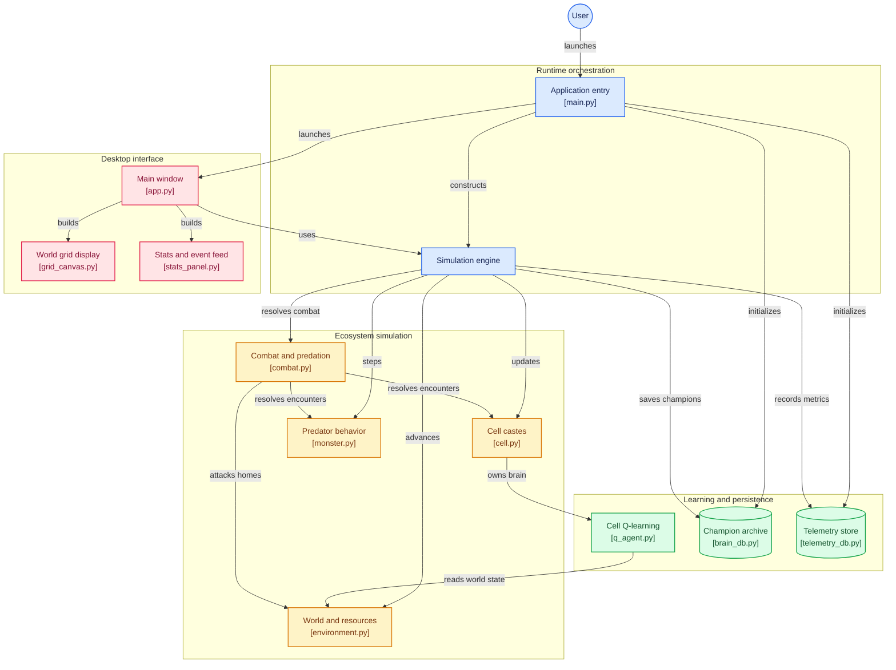

<div align="center">

# Life01 — Ecosistema Evolutivo y Civilización Celular
### Vida Artificial, Aprendizaje por Refuerzo Descentralizado (Q-Learning) y Expansión Territorial

[](https://www.python.org/)
[](https://customtkinter.tomschimansky.com/)
[](https://www.sqlite.org/)
[](tests/)
[](#arquitectura-de-aprendizaje-y-genética)
[](#características-del-ecosistema-v13)

<p align="center">
  <b>Simulación interactiva multi-agente en una malla primordial de 10,201 casillas (101&times;101).</b><br/>
  Agentes con mentes autónomas aprenden a recolectar alimento, huir del anochecer, cazar monstruos depredadores, fundar asentamientos territoriales y transmitir su conocimiento a través de selección natural y mutación genética.
</p>

[Comenzar](#instalación-y-ejecución) • [Arquitectura](#arquitectura-del-sistema) • [Mecánicas Ecológicas](#características-del-ecosistema-v13) • [IA & Genética](#arquitectura-de-aprendizaje-y-genética) • [Interfaz](#interfaz-gráfica-y-controles) • [Pruebas](#pruebas-automatizadas)

---

</div>

## Tabla de Contenidos

- [Descripción General](#descripción-general)
- [Arquitectura del Sistema](#arquitectura-del-sistema)
  - [Diagrama de Flujo de Componentes](#diagrama-de-flujo-de-componentes)
- [Características del Ecosistema (v1.3)](#características-del-ecosistema-v13)
  - [1. Castas Celulares Especializadas](#1-castas-celulares-especializadas)
  - [2. Monstruos Depredadores Heurísticos](#2-monstruos-depredadores-heurísticos)
  - [3. Sistema de Combate y Depredación](#3-sistema-de-combate-y-depredación)
  - [4. Expansión Territorial y Fusión de Hogares](#4-expansión-territorial-y-fusión-de-hogares)
  - [5. Dinámica Demográfica y Comida Escalable](#5-dinámica-demográfica-y-comida-escalable)
  - [6. Feed de Hitos y Telemetría en Tiempo Real](#6-feed-de-hitos-y-telemetría-en-tiempo-real)
- [Arquitectura de Aprendizaje y Genética](#arquitectura-de-aprendizaje-y-genética)
  - [Q-Learning Descentralizado e Individual](#q-learning-descentralizado-e-individual)
  - [Espacio de Estados y Acciones](#espacio-de-estados-y-acciones)
  - [Función de Aptitud Biológica (Fitness)](#función-de-aptitud-biológica-fitness)
  - [Persistencia: Salón de la Fama y Telemetría](#persistencia-salón-de-la-fama-y-telemetría)
- [Estructura del Proyecto](#estructura-del-proyecto)
- [Interfaz Gráfica y Controles](#interfaz-gráfica-y-controles)
- [Instalación y Ejecución](#instalación-y-ejecución)
- [Pruebas Automatizadas](#pruebas-automatizadas)
- [Licencia](#licencia)

---

## Descripción General

**Life01** es una simulación evolutiva que investiga cómo emergen comportamientos complejos y estrategias de supervivencia a partir de reglas biológicas simples combinadas con aprendizaje por refuerzo:

- **Ecosistema de Castas**: Población diferenciada entre células recolectoras (proletariado biológico) y células cazadoras/constructoras con capacidad defensiva y arquitectónica.
- **Presión Selectiva Real**: Depredadores nocturnos errantes que cazan activamente e intentan asediar los asentamientos de la colonia.
- **Mentes Propias en Memoria**: A diferencia de modelos con un cerebro global centralizado, en Life01 cada individuo cuenta con su propia instancia de `QLearningAgent`, tomando decisiones independientes basadas en su entorno sensorial inmediato.
- **Herencia Epigenética y Mutación**: Las descendientes heredan la tabla de políticas de la célula progenitora con una tasa de mutación configurable, seleccionando a la **Célula Alfa** al final de cada generación para guiar la evolución histórica.
- **Ingeniería Territorial Continua**: Cuando los asentamientos celulares se expanden y entran en contacto, el sistema fusiona sus territorios en un único dominio contiguo sin artefactos geométricos.

---

## Arquitectura del Sistema

La aplicación está diseñada bajo una arquitectura modular y desacoplada dividida en 4 subsistemas principales: **Runtime Orchestration**, **Ecosystem Simulation**, **Learning & Persistence**, y **Desktop Interface**.

### Diagrama de Flujo de Componentes

El siguiente diagrama ilustra la interacción entre los módulos de la aplicación, el flujo de ejecución y las dependencias de datos:



### Descripción de Capas:
1. **Runtime Orchestration (`main.py`, `simulation_engine.py`)**: Coordina el ciclo de vida del proceso, la temporización de ciclos y la sincronización entre el estado de simulación y la UI.
2. **Ecosystem Simulation (`environment.py`, `cell.py`, `monster.py`, `combat.py`)**: Define las entidades espaciales, reglas de movimiento (vecindario de Moore), consumo de recursos, combate y asedio.
3. **Learning & Persistence (`q_agent.py`, `brain_db.py`, `telemetry_db.py`)**: Gestiona las políticas $Q(s, a)$, la selección por aptitud genética y el almacenamiento transaccional en SQLite.
4. **Desktop Interface (`app.py`, `grid_canvas.py`, `stats_panel.py`)**: Visualización gráfica basada en CustomTkinter con aceleración de dibujo vectorial en Canvas y gráficos de tendencias poblacionales en Matplotlib.

---

## Características del Ecosistema (v1.3)

### 1. Castas Celulares Especializadas

| Característica | Células Blancas (Recolectoras) | Células Cazadoras (Cian `#38bdf8`) |
| :--- | :--- | :--- |
| **Rol Ecológico** | Recolección masiva de nutrientes | Defensa territorial, depredación y arquitectura |
| **Dieta** | Exclusivamente comida roja vegetal | Doble vía: comida roja o carne de monstruo |
| **Combate** | Nulo (presa vulnerable inmediata) | Activo (combate estocástico en adyacencia) |
| **Construcción** | No construyen hogares | Fundan nuevos hogares $5\times 5$ si hay 2 blancas cerca |
| **Genética de Parto** | 75% Blanca / 25% Cazadora | 50% Cazadora / 50% Blanca |

### 2. Monstruos Depredadores Heurísticos

Los monstruos (representados en vino tinto `#881337`) actúan como depredadores de ápice que regulan la población:

- **Zona de Exclusión de Nacimiento ($\ge 25$ casillas)**:
  - Al iniciar la generación siempre aparece 1 monstruo. En días posteriores existe una probabilidad diaria del **15%** de spawn.
  - Para evitar la aniquilación prematura de colonias nacientes, los monstruos nunca aparecen a menos de 25 casillas de distancia de cualquier hogar activo (rango seguro preferente entre 25 y 50 casillas).
  - Si la colonia elimina a todos los monstruos, reaparece uno automáticamente tras 1 día de ausencia de depredadores.
- **Reloj de Inanición (3 días / 30 ciclos)**:
  - Cada monstruo posee una reserva vital de **30 ciclos**. Cada paso sin alimentarse decrementa su contador. Al llegar a cero, muere por inanición.
  - Devorar una célula o demoler un hogar restaura su contador a 30 ciclos completos.
- **Visión e Inteligencia Táctica (8 casillas)**:
  - **Hambre activa (`hp_cycles < 30`)**: Prioriza localizar y cazar a la célula viva más cercana para sobrevivir.
  - **Saciado (`hp_cycles >= 30`)**: Prioriza localizar hogares y destruirlos para diezmar a la colonia.
  - Fuera del rango de visión, deambula con inercia direccional estocástica.

### 3. Sistema de Combate y Depredación

Cuando una entidad se encuentra en adyacencia de Chebyshev ($dist \le 1$):

```
       ┌────────────────────────┐
       │ Encuentro Adyacente    │
       └───────────┬────────────┘
                   │
         ¿Hay Cazadora cerca?
          ├── SÍ ──> Combate Estocástico:
          │          ├── 45%: Victoria Cazadora (Monstruo devorado, +5.0 Reward)
          │          ├── 45%: Victoria Monstruo (Cazadora devorada, Monstruo saciado)
          │          └── 10%: Empate (Ambos sobreviven en posición)
          │
          └── NO ──> Presa Fácil:
                     └── 100%: Monstruo devora Célula Blanca inmediatamente
```

### 4. Expansión Territorial y Fusión de Hogares

Las células cazadoras pueden fundar nuevos centros poblacionales bajo condiciones favorables:

1. **Requisitos de Fundación**:
   - La cazadora debe haberse alimentado durante el día.
   - Debe contar con al menos **2 células blancas vivas** en su radio local $5\times 5$.
   - Debe superar el umbral de probabilidad con decaimiento según el número actual de hogares:
     $$P(\text{construir}) = \max\left(0.15, \; 1.00 \times 0.50^{(\text{hogares} - 1)}\right)$$
2. **Fusión Territorial Contigua**:
   - Cuando un nuevo asentamiento de $5\times 5$ intersecta o colisiona con el territorio de un hogar existente, ambos se combinan en un único asentamiento continuo (`Home.merge_with()`).
   - Se eliminan divisiones internas redundantes: el renderizador unifica las baldosas en un marco exterior esmeralda cohesivo, preservando los núcleos verdes brillantes de cada centro cívico.
   - Cualquier célula puede refugiarse en **cualquiera de los hogares activos** (orientándose dinámicamente al más cercano).
3. **Demolición con Ventana de Hibernación**:
   - Destruir una casa toma 1 ciclo al monstruo, lo sacia y lo induce a **hibernación durante 4 ciclos consecutivos**, creando una ventana táctica crucial para que las cazadoras lo rodeen o escapen.
4. **Vigilia Nocturna**:
   - Los monstruos no duermen de noche; continúan patrullando y cazando en la oscuridad a las células rezagadas.

### 5. Dinámica Demográfica y Comida Escalable

- **Ciclo Temporal**: 1 día = 10 ciclos; 1 generación = 1,000 ciclos (100 días de simulación).
- **Nutrientes Adaptativos**: La comida roja se regenera diariamente en proporción directa a la población viva:
  $$\text{Comidas Diarias} = 2 + \lfloor 0.4 \times \text{Población Total} \rfloor$$
- Cada comida no recolectada caduca tras **30 ciclos** (3 días).
- **Supervivencia Diaria**:
  - Toda célula que consuma alimento y alcance el perímetro de cualquier hogar al final del ciclo 9 sobrevive, recupera HP y tiene un **67% de probabilidad de reproducirse**.
  - Si no comió o no regresó al hogar, pierde 1 HP (máximo 2 HP). Con 0 HP perece.

### 6. Feed de Hitos y Telemetría en Tiempo Real

El panel lateral incorpora una marquesina de dos líneas que registra hitos acumulados:
- `-- se ha construido un nuevo hogar (Total: X)`
- `-- se han eliminado N monstruos (marcas a partir de 5)`
- `-- han nacido N células blancas (marcas: 50, 100, 200, ...)`
- `-- han nacido N células cazadoras (marcas: 10, 50, 100, ...)`

---

## Arquitectura de Aprendizaje y Genética

### Q-Learning Descentralizado e Individual

Cada célula es un agente independiente con su propia tabla de valores de acción $Q(s, a)$. La regla de actualización temporal es:

$$Q(s, a) \leftarrow Q(s, a) + \alpha \left[ r + \gamma \max_{a'} Q(s', a') - Q(s, a) \right]$$

- **Tasa de Aprendizaje ($\alpha$)**: $0.15$
- **Factor de Descuento ($\gamma$)**: $0.92$
- **Exploración ($\epsilon$)**: Inicia en $0.70$ con decaimiento a $0.985$ por ciclo hasta un piso de $\epsilon_{min} = 0.05$.

### Espacio de Estados y Acciones

El estado sensorial individual se codifica como una tupla discreta compacta:

$$\text{Clave de Estado} = \langle \text{dir\_food}, \; \text{dir\_home}, \; \text{time\_risk}, \; \text{has\_eaten}, \; \text{food\_adj}, \; \text{hp} \rangle$$

- $\text{dir\_food} \in \{0..7\}$ (sector octante de Moore) u $8$ (sin comida visible).
- $\text{dir\_home} \in \{0..7\}$ u $8$ (dentro del hogar).
- $\text{time\_risk} \in \{0, 1, 2\}$: Nivel de urgencia temporal según la distancia de regreso frente a los ciclos diurnos restantes ($10 - (\text{ciclo} \pmod{10})$).
- $\text{has\_eaten} \in \{0, 1\}$.
- $\text{food\_adj} \in \{0, 1\}$.
- $\text{hp} \in \{1, 2\}$.

**Espacio de Acciones (9 acciones)**:
- $0 \dots 7$: Movimiento en vecindario de Moore (Norte, Noreste, Este, Sureste, Sur, Suroeste, Oeste, Noroeste).
- $8$: Consumir recurso adyacente.

### Función de Aptitud Biológica (Fitness)

Al culminar una generación (por extinción o al alcanzar los 1,000 ciclos), el motor evalúa a toda la población para coronar a la **Célula Alfa**:

$$\text{Fitness} = (\text{Días Sobrevividos} \times 50.0) + (\text{Comida Total} \times 30.0) + (\text{HP} \times 10.0) + (\text{Monstruos Eliminados} \times 40.0)$$

El cerebro de la Célula Alfa se serializa y clona para fundar la siguiente generación, aplicando una mutación gaussiana estocástica ($\mu = 0.08, \sigma = 0.15$) sobre sus valores $Q$.

### Persistencia: Salón de la Fama y Telemetría

- **`brain.db` (Salón de la Fama Top-10)**:
  - Solo conserva los **10 genomas más sobresalientes** de toda la historia evolutiva.
  - Utiliza poda automática basada en puntuación de aptitud, manteniendo el archivo siempre por debajo de **~4 MB** independientemente de las semanas de ejecución.
- **`telemetry.db` (Métricas en Tiempo Real)**:
  - Registra las series temporales de población viva, desglosada por casta, vida media y eventos por ciclo.
  - Opera con modo de diario SQLite `PRAGMA journal_mode=WAL;` para máxima velocidad sin bloqueos con la interfaz gráfica.

---

## Estructura del Proyecto

```plaintext
Life01/
├── ai/
│   └── q_agent.py              # Agente individual de Q-Learning (estados, políticas, mutación)
├── database/
│   ├── brain_db.py             # Archivo SQLite Top-10 del Salón de la Fama
│   └── telemetry_db.py         # Serie temporal y métricas poblacionales en SQLite WAL
├── gui/
│   ├── app.py                  # Ventana principal en CustomTkinter (modo oscuro)
│   ├── grid_canvas.py          # Renderizador vectorial de la malla 101x101 y zoom dinámico
│   └── stats_panel.py          # Panel lateral: gráficos de matplotlib, feed y controles
├── simulation/
│   ├── cell.py                 # Modelo celular: castas (Blanca / Cazadora), salud y genética
│   ├── combat.py               # Motor de combate estocástico y depredación
│   ├── environment.py          # Mundo 101x101, gestión de hogares, fusión y recursos
│   ├── monster.py              # Depredadores vino tinto: visión, hambre y asedio
│   └── simulation_engine.py    # Orquestador del bucle ecológico y selección natural
├── tests/
│   ├── test_gui_integration.py # Pruebas de integración de la interfaz
│   ├── test_simulation.py      # Pruebas unitarias de mecánicas base
│   └── test_v1_3.py            # Pruebas de combate, castas, fusión y zona de exclusión
├── backups/                    # Respaldos de genomas y versiones históricas
├── main.py                     # Punto de entrada de la aplicación
├── requirements.txt            # Dependencias del proyecto
└── README.md                   # Documentación técnica completa
```

---

## Interfaz Gráfica y Controles

La interfaz está construida sobre una paleta moderna en modo oscuro (`#0b0f19`):

<div align="center">

| Control / Indicador | Función |
| :--- | :--- |
| **Pausar / Reanudar** | Detiene o reanuda la simulación en cualquier instante del ciclo. |
| **Velocidad (`1x`, `5x`, `Turbo`)** | Controla el retardo del bucle (`1.0s`, `0.2s`, `0.0s` a máxima velocidad de CPU). |
| **Escala de Zoom (`6x`, `7x`, `8x`)** | Modifica dinámicamente el tamaño de pixelado de la malla según la pantalla. |
| **Guardar y Salir** | Persiste el genoma del mejor campeón en `brain.db` y cierra de forma segura. |
| **Gráfica de Población** | Curva en tiempo real desglosada: blanco para recolectoras, celeste para cazadoras. |
| **Feed de Avisos** | Terminal minimalista que anuncia hitos de construcción, combate y demografía. |

</div>

---

## Instalación y Ejecución

### Requisitos Previos
- **Python 3.10** o superior instalado en el sistema.
- Soporte de interfaz gráfica (Tkinter viene incluido por defecto en los instaladores estándar de Python).

### 1. Clonar el Repositorio
```bash
git clone https://github.com/itsluuis/life01.git
cd life01
```

### 2. Crear y Activar un Entorno Virtual (Opcional)
```bash
# Windows
python -m venv venv
venv\Scripts\activate

# Linux / macOS
python3 -m venv venv
source venv/bin/activate
```

### 3. Instalar Dependencias
```bash
pip install -r requirements.txt
```

### 4. Iniciar la Simulación
```bash
python main.py
```

---

## Pruebas Automatizadas

El proyecto cuenta con una suite integral de 19 pruebas unitarias y de integración que cubren la resolución de combate, reglas de reproducción, herencia epigenética, algoritmos de fusión de hogares y renderizado gráfico:

```bash
python -m unittest discover tests
```

Salida esperada:
```bash
----------------------------------------------------------------------
Ran 19 tests in ~4.5s

OK
```

---

## Licencia

Este proyecto se distribuye bajo fines educativos y de investigación en Vida Artificial y Sistemas Complejos Adaptativos. Desarrollado por [@itsluuis](https://github.com/itsluuis).
